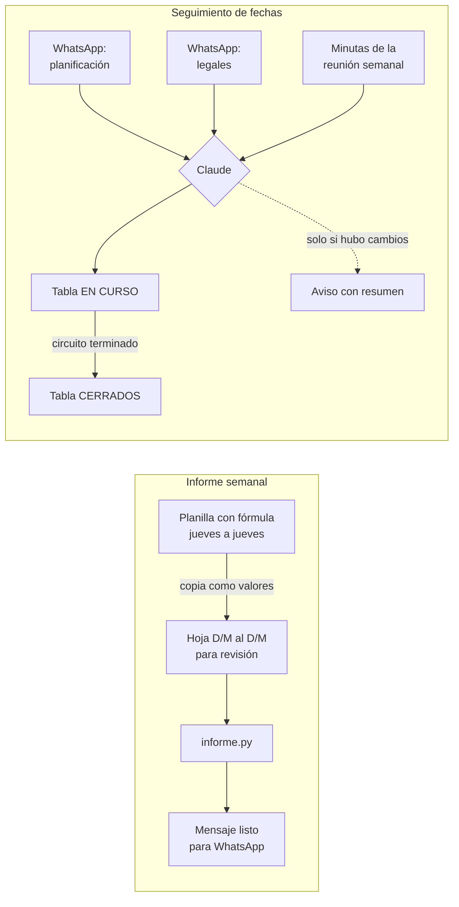

# Automatizaciones para Eventos Masivos

Tareas programadas con [Claude](https://claude.ai) que automatizan parte del trabajo de seguimiento de eventos masivos en la Ciudad de Buenos Aires: el armado del informe semanal y el seguimiento del circuito de validación de fechas.


> Versión pública para portfolio: los identificadores de documentos, grupos y personas están reemplazados por variables y roles. Ver [`config.example.md`](config.example.md).

## Qué hay

| Automatización | Cuándo corre | Qué hace | Herramientas |
|---|---|---|---|
| [Informe semanal](informe-semanal/) | Jueves 07:47 | Congela en una hoja nueva los eventos de jueves a jueves para revisión y arma el mensaje "Principales eventos de la semana" | Google Sheets · Python |
| [Seguimiento de fechas](seguimiento-fechas/) | Cada 30 min | Lee dos grupos de WhatsApp y las minutas de la reunión semanal, y mantiene al día una tabla con el estado de cada fecha en el circuito de validación | WhatsApp Web (Claude in Chrome) · Google Docs |

## Cómo funciona



## Criterios de diseño

- **No inventar datos.** Lo que no está claro en las fuentes queda marcado como "a confirmar".
- **Incremental.** Cada corrida lee desde la última marca registrada en el documento, así una corrida perdida (computadora apagada) se recupera sola en la siguiente.
- **Silencio por defecto.** Solo notifica cuando hay novedades o un error real.
- **Solo lectura en WhatsApp.** Nunca escribe ni envía mensajes.
- **Prompts estructurados:** rol, contexto, objetivo, formato y restricciones.

## Estructura

```
├── informe-semanal/
│   ├── prompt.md          prompt de la tarea programada
│   ├── informe.py         genera el mensaje a partir de la planilla
│   └── ejemplo/           datos de ejemplo
├── seguimiento-fechas/
│   └── prompt.md          prompt de la tarea programada
├── tests/                 tests de informe.py (corren en GitHub Actions)
└── config.example.md      variables y roles
```

## Probar el script

```bash
python3 informe-semanal/informe.py informe-semanal/ejemplo/valores.json 19/11/2026
python3 -m unittest discover -s tests -v
```
